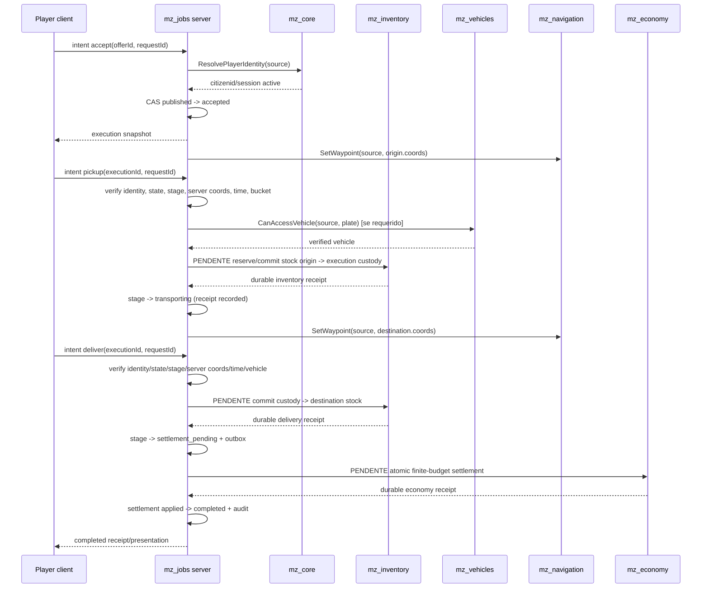

# MZ Jobs — Wave 0: auditoria e blueprint

**Data da inspeção:** 2026-10-25  
**Escopo:** documentação e análise estática; nenhuma implementação de runtime  
**Status global:** `VERIFICADO` para inventário e contratos citados; `PROPOSTO` para a arquitetura; `PENDENTE` para decisões e contratos ausentes  
**Runtime FiveM:** `RUNTIME NOT RUN`  
**Banco/MySQL:** `NOT RUN`; nenhum DDL foi executado  
**Referências de terceiros:** somente leitura; nenhum arquivo foi executado, alterado ou copiado

## 0. Resultado executivo

O repositório comporta um `mz_jobs` independente sem expandir o `mz_core`. A divisão correta é:

- `mz_jobs`: catálogo de templates, ofertas, reserva/aceite, execução, estágios, progressão individual e coordenação da entrega;
- `mz_economy`: única autoridade de dinheiro, ledger, débito de orçamento e crédito ao jogador;
- `mz_inventory`: única autoridade de itens, estoques, reservas e transferências;
- `mz_population`: demanda agregada, workforce virtual e futura substituição por agentes virtuais, sem materializar peds;
- `mz_org`: vínculos, cargo, duty, capability e folha organizacional;
- `mz_navigation`: rota/waypoint;
- `mz_target` e `mz_radialmenu`: apresentação de intenções de interação;
- `mz_frontend`: biblioteca visual/laboratório, não host FiveM de produção;
- `mz_police`/`mz_dispatch`: consequências e chamados criminais;
- `mz_vehicles`/`mz_garagem`: propriedade, acesso e lifecycle veicular.

O piloto de entrega física está **arquiteturalmente definido, mas bloqueado para implementação** por duas lacunas públicas:

1. `mz_inventory` não expõe reserva/transferência de estoque entre origem, custódia do jogador e destino com chave idempotente e recibo durável. Os exports genéricos de jogador não recebem `GetInvokingResource` nem `operationId` (`mz_inventory/server/exports.lua:129-139`; `mz_inventory/server/service.lua:4620-4635`).
2. `mz_economy` não expõe uma liquidação atômica “orçamento finito -> jogador”. `AddMoney` é idempotente quando recebe metadata válida, porém é um crédito isolado e retorna apenas `true` no caminho normal/replay (`mz_economy/server/accounts/service.lua:597-728`). O comércio de conta de organização possui recibo, mas só aceita dois propósitos e só pode ser chamado por `mz_org` (`mz_economy/server/accounts/org_accounts.lua:497-513,698-709,903-938`).

Portanto, usar uma tabela de saldo dentro de `mz_jobs`, encadear `RemovePlayerItem`/`AddPlayerItem`, ou pagar com `AddMoney` sem débito canônico seria uma violação de owner e não faz parte deste blueprint.

## 1. Método e fonte de verdade

### VERIFICADO

- O plano existente foi lido integralmente: `mz_jobs/PLANO_MESTRE_MZ_JOBS.md:1-371`.
- `graphify-out/graph.json` existe e foi consultado primeiro para localizar relações. A consulta alcançou 538 nós, mas retornou muito ruído de referências/artefatos; toda conclusão abaixo foi então conferida no código real.
- Foram localizados manifests reais dos resources MZ citados. `mz_starter` é um pacote de configuração, não um resource com manifest. `mz_frontend` é um workspace React/Vite, não um resource FiveM de produção (`mz_frontend/README.md:3-13,37,65-74`).
- `ref/trabalhos` existe e contém exatamente **32 diretórios principais**. A inspeção evitou binários/assets pesados e não executou código de terceiros.
- A raiz agregadora `D:\git-hub\repo_oficial` não é um único repositório Git; não foi usado Git para inferir a verdade do código.

### Regra de evidência

`VERIFICADO` significa que o comportamento está presente no arquivo/linha citados. Não significa que o fluxo passou no FiveM. `PROPOSTO` não é API existente. `PENDENTE` bloqueia implementação ou exige uma decisão de owner.

## A. Owners e mapa de dependências

| Owner | Responsabilidade verificada | Evidência | Uso permitido por `mz_jobs` |
|---|---|---|---|
| `mz_core` | identidade, sessão e estado vital do jogador; permanece congelado | `mz_core/fxmanifest.lua:7,48`; `mz_core/server/player/exports.lua:85-87,214-237`; `mz_core/server/player/state_exports.lua:110-112` | somente leitura de identidade/sessão/estado; nenhum facade novo |
| `mz_economy` | contas, mutações, ledger e reporting financeiros | `mz_economy/fxmanifest.lua:7,31`; `mz_economy/server/accounts/exports.lua:1-71` | settlement por contrato canônico; jamais saldo próprio |
| `mz_population` | população virtual/estatística e demanda por zona | `mz_population/fxmanifest.lua:7`; `mz_population/README.md:5-7,143-145` | leitura de zona/demanda; jobs virtuais só em wave futura |
| `mz_inventory` | inventários, itens e mutações de estoque | `mz_inventory/fxmanifest.lua:7,56`; `mz_inventory/server/exports.lua:129-139` | transferência/reserva somente após contrato idempotente próprio do owner |
| `mz_org` | organizações, memberships, grade, duty e capabilities | `mz_org/fxmanifest.lua:6,11`; `mz_org/server/domain/exports.lua:1-7,256-278` | elegibilidade opcional; não confundir carreira individual com cargo |
| `mz_target` | detecção/apresentação de interação por entity/model/global | `mz_target/fxmanifest.lua:8`; `mz_target/client/main.lua:681-700` | registrar/remover opções owner-aware; nunca autorizar progresso |
| `mz_radialmenu` | opções contextuais independentes | `mz_radialmenu/fxmanifest.lua:7`; `mz_radialmenu/client/main.lua:314-328` | intenção de abrir/abandonar/retomar; cleanup por owner |
| `mz_navigation` | geodata, POIs, layers, picker e GPS | `mz_navigation/fxmanifest.lua:8,48`; `mz_navigation/server/main.lua:67-117` | waypoint/POI; coordenadas canônicas vêm do contrato server-side |
| `mz_vehicles` | domínio, propriedade e acesso veicular | `mz_vehicles/fxmanifest.lua:7,59`; `mz_vehicles/server/domain/exports.lua:20-70` | validar veículo do jogador; não criar ledger/frota paralela |
| `mz_garagem` | lifecycle de garagem integrado a veículos/org | `mz_garagem/fxmanifest.lua:7,52` | sem integração no piloto; futuro somente via contrato público do owner |
| `mz_phone` | shell e apps do telefone | `mz_phone/fxmanifest.lua:8,73`; `mz_phone/web/apps/registry.js:1-50,118-120` | futuro; registro atual é JS estático, não API pública cross-resource |
| `mz_frontend` | componentes/tokens/bridges demonstrativos | `mz_frontend/README.md:3-13,37,65-74` | referência visual; não publicar playground/hosts mock como NUI |
| `mz_police` | operações policiais server-authoritative | `mz_police/fxmanifest.lua:6,71` | sem chamada direta no piloto legal; ilegalidades entram depois |
| `mz_dispatch` | chamados compartilhados server-side | `mz_dispatch/fxmanifest.lua:7,24`; `mz_dispatch/server/events.lua:156-166` | criar ocorrência válida em jobs ilegais futuros, com categoria existente |
| `mz_starter` | ordem de boot/configuração | `mz_starter/cfg/resources.cfg:21-66` | Wave futura adiciona `mz_jobs` depois das dependências; Wave 0 não edita |

### Grafo de dependências proposto

```text
mz_core ───────────────┐
mz_economy ────────────┤
mz_inventory ──────────┤
mz_org ────────────────┤
mz_population ─────────┤
mz_navigation ─────────┼──> mz_jobs
mz_vehicles ───────────┤       │
mz_target (client) ────┤       ├── eventos/auditoria próprios
mz_radialmenu (client) ┘       └── intents client -> validação server

mz_phone / mz_frontend / mz_dispatch / mz_police
        └── integrações opcionais e posteriores, não dependências da base Wave 1
```

`mz_jobs` não deve ser dependência de nenhum owner acima. Integrações opcionais devem falhar fechadas para mutações e degradar apenas apresentação/rota quando seguro.

## B. Matriz das APIs reais

### B1. Identidade e estado

| Operação real | Entrada / retorno | Autorização e fail-mode | Restart/reconnect | Teste/evidência | Lacuna |
|---|---|---|---|---|---|
| `exports['mz_core']:ResolvePlayerIdentity(source)` | `source:number` -> `{ok, error?, source, accountId, characterId, citizenid, sessionId, active, name, phone}` | leitura server-side; falha `session_not_found` ou `character_not_active` | resolver novamente a cada intent e após relog; limpar estado source-keyed no evento de sessão fechada | `mz_core/server/player/exports.lua:76-87`; `mz_core/server/identity/service.lua:551-579` | suficiente |
| `exports['mz_core']:GetPlayerSession(source)` | `source` -> snapshot ou `nil` | leitura sem caller allowlist | `sessionId` não é identidade persistente | `mz_core/server/player/exports.lua:214-216` | usar só como vínculo efêmero |
| `exports['mz_core']:CanPlayerPerformAction(source, action)` | -> `ok:boolean, {allowed, revision, deathState}` | action deve estar registrada; fail-closed em estado ausente ou morto | revalidar em cada mutação | `mz_core/server/player/state_service.lua:1170-1184` | é preciso cadastrar a action no owner correto se a Wave 1 realmente usar; não editar Core na Wave 0 |
| evento local `mz_core:server:identitySessionClosed` | `(source, sessionId?, reason)` | evento interno server | cancela locks/source caches; execução durável continua por `citizenid` | `mz_core/server/identity/service.lua:530-548` | suficiente |
| `exports['mz_core']:CreateDetailedLog(scope, action, payload)` | boolean/resultado do serviço | export genérico, sem allowlist aparente | logs não substituem event log transacional de jobs | `mz_core/server/logs/exports.lua:14-16` | definir campos e política de retenção antes do uso |

### B2. Dinheiro

| Operação real | Entrada / retorno | Autorização e fail-mode | Restart/replay | Teste/evidência | Veredito para jobs |
|---|---|---|---|---|---|
| `GetMoney(source)` | -> tabela `money` ou `nil` | jogador deve estar carregado | snapshot online | `mz_economy/server/accounts/exports.lua:1-3`; `service.lua:591-595` | leitura apenas |
| `AddMoney(source, account, amount, metadata)` | -> `true` ou `false,error` | `account` canônico; inteiro positivo; caller real é injetado no metadata | idempotência persistida se key 16-64 `[A-Za-z0-9_-]`; replay retorna apenas `true` | `exports.lua:36-57`; `service.lua:247-298,597-728,747-762`; `tests/account_behavior_harness.lua:90-93` | não representa débito de orçamento; não usar sozinho como settlement |
| `RemoveMoney(...)` | mesma forma | falha `not_enough_money` e demais validações | mesma idempotência | `exports.lua:55-57`; `service.lua:764-780` | não encadear manualmente com crédito |
| `GetOperationResult(source,key,operation)` | -> `{ok,...}` | escopo vem de `GetInvokingResource`; jogador precisa estar online | consulta recibo persistido do caller | `exports.lua:67-71`; `service.lua:301-344` | útil para reconciliação de uma futura operação canônica |
| `GetOrganizationAccountCommerceCapabilities()` | -> capabilities, ready, purposes | leitura pública | informa indisponibilidade | `org_accounts.lua:698-709,927-929` | hoje só `facility_purchase`/`furniture_purchase` |
| `SpendOrganizationAccount` / `RefundOrganizationAccount` | -> `true,receipt` ou `false,error` | caller obrigatório `mz_org`; purpose e resource allowlisted | idempotente e persistido | `org_accounts.lua:712-803,903-938`; `mz_testkit/tests/mz_core/org_account_commerce_contract_harness.lua:14-31` | **bloqueado** para `mz_jobs`; não contornar |
| `RecordTransaction(data)` | payload livre -> serviço | registra transação/reporting; não é débito/crédito de conta | não prova settlement | `mz_economy/server/main.lua:11-13` | não usar como dinheiro |

**PENDENTE — contrato obrigatório no owner:** uma operação única e atômica que valide budget/purpose/caller, debite fonte finita, credite o `citizenid`/conta e devolva recibo durável com `transactionRef`, `budgetBefore/After`, `playerBefore/After`, `replayed`. O nome público e a política pertencem ao `mz_economy`; este documento deliberadamente não inventa um export.

### B3. Itens e estoque

| Operação real | Entrada / retorno | Autorização e fail-mode | Restart/replay | Teste/evidência | Veredito |
|---|---|---|---|---|---|
| `HasPlayerItem(source,item,amount)` | -> `has:boolean,total:number` ou erro | jogador/contexto válidos | leitura atual | `mz_inventory/server/exports.lua:129-131`; `service.lua:4605-4617` | prova auxiliar, não cadeia de custódia |
| `AddPlayerItem(source,item,amount,metadata)` | -> resultado de `executeInventoryMutation` | export não verifica caller | transacional local, sem `operationId` público | `exports.lua:133-135`; `service.lua:4620-4626` | inadequado para entrega idempotente |
| `RemovePlayerItem(source,item,amount)` | idem | export não verifica caller | sem recibo durável consultável | `exports.lua:137-139`; `service.lua:4629-4635` | inadequado para entrega idempotente |
| `ReserveMedicalItem(...)` | reserva/replay em memória | writer allowlist somente `mz_medical`; reader `mz_medical`,`mz_admin` | terminais retidos em memória, não base genérica | `mz_inventory/config.lua:40-44`; `service.lua:4638-4660` | não reutilizar nem ampliar informalmente |

**PENDENTE — contrato obrigatório no owner:** reserva/commit/cancel de transferência entre estoque origem, custódia de execução e estoque destino, escopado por caller real, `operationId` durável, fingerprint, quantidade inteira, metadata fechada e recibo consultável. O `mz_inventory` continua único writer de quantidades.

### B4. Organização, população, rota e veículo

| Operação real | Semântica | Auth/falha | Uso em jobs |
|---|---|---|---|
| `mz_org:GetPlayerOrgs(source)` / `CanOrg(source,code,capability)` | contexto online e capability | owner valida membership/capability | só templates que exigem org (`mz_org/server/domain/exports.lua:1-7`) |
| `GetCharacterOrganizations(citizenid)` / `HasOrgPermission` / `IsOnDuty` | leitura por identidade persistente | retorna owner state; desconhecido falha fechado | não traduzir para XP/carreira (`exports.lua:256-278`) |
| `mz_population:GetZoneDemand(zoneId)` | `{ok,data}` ou `{ok=false,error}` | read-only e readiness | peso de publicação futuro (`mz_population/server/exports.lua:33-35`; `service.lua:65-85`) |
| `ResolveZoneByCoords(x,y,z)` | snapshot da zona por raio/prioridade | valida números finitos; `no_zone_found` | atribuir distrito server-side (`service.lua:87-118`) |
| `mz_navigation:SetWaypoint(source,coords)` | `ok,error` | valida contexto e bounds antes de evento client | rota do estágio (`mz_navigation/server/main.lua:106-117`) |
| `RegisterLayer` / `UpsertPOI` / removals | registros owner-aware | exige `GetInvokingResource`; owner só remove o próprio | POIs opcionais, reconstruídos em restart (`main.lua:67-89`) |
| `mz_vehicles:CanAccessVehicle(source,plate)` | `true,vehicle` ou `false,error` | identidade, propriedade/grant pelo owner | piloto pode aceitar veículo já acessível (`mz_vehicles/server/domain/service.lua:1090-1116`) |
| `EnsureVehicleAccessForPlayer` | valida e concede runtime access | muta acesso após validação | desnecessário no piloto; evitar (`service.lua:1119-1164`) |
| `mz_garagem` | lifecycle/storage de veículos | owner separado | sem uso no piloto |

`mz_population` está propositalmente headless, estático e sem SQL/client/eventos (`mz_population/README.md:5-7`). A simulação está desabilitada e o tick é neutro (`mz_population/server/simulation.lua:3-20`). Não existe hoje contrato de “NPC executou job” nem write de demanda; qualquer scheduler NPC fica para wave posterior ao owner definir isso.

### B5. Interação, UI e crime

| Operação real | Auth/cleanup | Uso e limites |
|---|---|---|
| `mz_target:AddTargetEntity/Model/...` e removals | owner derivado de `GetInvokingResource`; opções do owner são removidas no stop | apresentar intenção; seleção pode disparar evento server, que deve revalidar tudo (`mz_target/client/main.lua:122-126,681-700,720-784,874-878`) |
| `mz_radialmenu:RegisterOption/RemoveOption/GetOption` | handle owner-scoped; stop remove opções e fecha menu stale | ações contextuais e cleanup (`mz_radialmenu/client/main.lua:56-100,134-157,279-328`) |
| `mz_phone` `registerApp` | registro global JS dentro do próprio bundle | não é export/API para outro resource; integração exige alteração deliberada do host e fica futura (`mz_phone/web/apps/registry.js:1-50,118-120`) |
| `mz_frontend` | mocks/hosts demonstrativos | não há host de produção nem contrato jobs; UI Wave 1 deve ser zero-NUI ou usar superfícies existentes (`mz_frontend/README.md:9-13,37,70-74`) |
| `mz_dispatch:CreateEmergencyCall(source,payload)` | identidade e posição obtidas server-side; payload fechado | futuro job ilegal pode pedir categoria existente; hoje apenas `general/gunshots/fight`, com `panic` interno (`mz_dispatch/server/events.lua:156-166`; `server/service.lua:184-200`; `server/bridge.lua:20-26,81-88`; `config.lua:49-58`) |

## C. Inventário das 32 referências

### Política comum de proveniência

Só `mycroft-jobforms-main` possui licença de projeto detectável: MIT (`ref/trabalhos/mycroft-jobforms-main/mycroft-jobforms-main/LICENSE:1-6`). Licenças `noty_license.txt` encontradas dentro de bundles pNotify cobrem a biblioteca embarcada, não o script pai. Na ausência de licença explícita, a decisão é **não copiar código, assets, SQL, textos ou UI**; apenas descrever ideias/mecânicas.

Foi encontrado um webhook Discord literal em `truck_logistics/server.lua:8-11`. O valor não é reproduzido aqui. Tratar como credencial comprometida, revogar/rotacionar fora desta Wave e jamais portar.

| Caminho relativo real | Tipo e mecânicas úteis | Dependências/eventos críticos | Licença, ameaça e decisão |
|---|---|---|---|
| `balaka_construtor-main` | legal; etapas de construção e requisito de ferramenta | vRP/estrutura antiga; item `ferramenta` (`README.md:9-21`) | **All Rights Reserved** (`README.md:75`); conceito apenas, cópia proibida |
| `big_empregos` | legal; catálogo de múltiplas entregas/pontos | vRP/Tunnel; `payment(codigo)` e eventos de caixas (`server.lua:20-29,95-125`); config repetida (`config.lua:8,116,...,1322`) | sem licença; risco alto de pagamento/event state genérico; só taxonomia conceitual |
| `devil_tubarao-main` | legal/ambiental questionável; caça, coleta e venda | vRP; spawn contínuo após abate (`Leia.txt:15-22`) | sem licença; pede crédito (`Leia.txt:25-27`); não copiar nem adotar loop infinito |
| `emprego_Corona` | legal; bar/serviço e logística associada | vRP e mapas/veículos agrupados | sem licença; ownership misturado; conceito de cadeia bar apenas |
| `emprego-jardineiro-free-fivem-VRPEX-main` | legal; jardinagem por etapas | vRPex, coords/client e pagamento | sem licença detectada; inspiração de stages, sem código |
| `Empregos` | legal; caça, caminhão, cerveja, eletricista, leiteiro, lenhador, lixo, mineração, motorista, pesca, táxi | vRP; vários `checkPayment`/give item; `Q_caminhoneiro/server.lua:4-17`, `Q_minerador/server.lua:75-116` | sem licença; SQL/economia/inventário próprios proibidos; bom catálogo de verbos |
| `inside-builder` | legal; progressão/nível e tarefas de obra | ESX; callback recebe `level` do client (`server/server.lua:25-44`) | sem licença; trust boundary insegura; conceito de XP apenas |
| `inside-busdriver` | legal; rota de ônibus e paradas | ESX; payout callback (`server/server.lua:4-7`) | sem licença; servidor não prova rota; conceito de sequência |
| `inside-carthief` | ilegal; roubo e entrega de veículo | ESX/pNotify; payout disparado pelo client | sem licença; alto risco de fraude; futuro só com veículos/dispatch canônicos |
| `inside-courier` | legal; coleta/entrega courier | ESX; payout aleatório em callback (`server/server.lua:4-7`) | sem licença; sem prova durável; conceito próximo ao piloto |
| `inside-farmer` | legal; coleta de produtos e acerto por contadores | ESX/pNotify; client envia quantidades (`client/client.lua:397-404`; `server/server.lua:4-10`) | sem licença; crítico: payout baseado no client; não copiar |
| `inside-fruitpicker` | legal; colher/transportar frutas | ESX/pNotify; client envia quantidade de payout | sem licença; mesma ameaça de contadores client-side |
| `inside-gardener` | legal; vários serviços de jardim, depósito de veículo | ESX/pNotify; client escolhe salário/quantidade (`client.lua:155,507-508,619-620`; `server.lua:28-33`) | sem licença; exploit financeiro direto; só variedade de stages |
| `inside-helicopter` | legal; piloto/rota aérea | ESX; payout callback (`server/server.lua:4-7`) | sem licença; veículo/rota sem prova server-side |
| `inside-illegalorders` | ilegal; sete tipos de pedido | ESX; sete callbacks de payout (`server/server.lua:4-49`) | sem licença; callback como prova é insuficiente; conceito de templates ilegais futuros |
| `inside-illegaltransportation` | ilegal; transporte, retorno e alerta policial | ESX/pNotify; evento policial e payout (`server/server.lua:8-16`) | sem licença; consequência policial ad hoc; adaptar somente via dispatch |
| `inside-moneywash` | ilegal; máquinas/etapas de lavagem | ESX; estado monetário próprio e callbacks/eventos | sem licença; duplica economy/dirty money e tem risco de race; não portar |
| `inside-selldrugs` | ilegal; venda a NPC e alerta policial | ESX; ped/client conduz venda e notify | sem licença; client/NPC não pode provar item/dinheiro; futuro inventory+dispatch |
| `inside-shoprobbery` | ilegal; caixas/roubo e polícia | ESX; callback aceita `money` do client (`server/server.lua:4-13`) | sem licença; vulnerabilidade crítica de mint; não copiar |
| `inside-warehouse` | legal; caixas/empilhadeira/armazém | ESX/pNotify; payout fornecido pelo client (`client/client.lua:173`; `server/server.lua:29`) | sem licença; boa composição espacial, autoridade inadequada |
| `mycroft-jobforms-main` | auxiliar; formulários de candidatura por emprego | ox_lib/ox_target, webhooks, evento de aplicação; sanitização alegada (`readme.md:7-24`) | MIT (`LICENSE:1-6`); possível adaptação futura com atribuição, mas recrutamento pertence a `mz_org`; não usar webhook como banco |
| `rc_blackPhone` | ilegal/auxiliar; marketplace em telefone | ESX, compras/SQL e itens/veículos | sem licença; duplica phone/economy/inventory/vehicles; não integrar |
| `rc_carDelivery` | legal; entrega de carros | ESX/pNotify; client fornece payout/config ao evento server | sem licença; usar apenas ideia de inspeção/entrega veicular |
| `rc_carRental` | auxiliar; aluguel e devolução | ESX; client envia valor de remoção | sem licença; duplica economy/vehicles/garage; não integrar |
| `rc_hud` | auxiliar; HUD de status/dinheiro | ESX/NUI | sem licença; fora do domínio jobs e duplica UI/state |
| `rc_Marketplace` | auxiliar/econômico; anúncio, compra e coleta | ESX/SQL; client envia item/preço (`client/main.lua:192`; `server/main.lua:18,59,142`) | sem licença; risco de preço/item/race; não portar |
| `rc_ramazon` | legal; encomenda, separação e entrega | ESX/pNotify/SQL; client passa produto/payout | sem licença do projeto; `noty_license` não cobre o todo; boa ideia de fulfillment, código proibido |
| `rc_VehicleShop` | auxiliar; loja de veículos | ESX/SQL; README diz “buying my script” (`README:1-5`) | presumivelmente comercial/proprietário; cópia expressamente vedada |
| `rc_vote` | auxiliar; eleição/votação | ESX/SQL | sem licença; fora do escopo jobs |
| `thor_transportadora-20261006T045631Z-1-001` | legal; transportadora simples | vRP; rota/pagamento em poucos arquivos | sem licença; conceito redundante com courier/logistics |
| `truck_logistics` | legal; contratos de frete, skills, frota, motoristas e empréstimo | vRP/SQL; client envia reward (`server.lua:323-347,636-675`); bloco de handlers duplicado; webhook literal | sem licença; risco crítico de segredo e autoridade, dívida alta; só conceitos de contrato/skill/frota |
| `vrp_tutorial` | auxiliar; tutorial/base vRP | vRP, UI/fluxo introdutório | sem licença; fora do piloto, não portar |

### Mecânicas aproveitáveis sem copiar implementação

- catálogo data-driven de contratos, sem uma config monolítica;
- estágios tipados (`pickup`, `transport`, `deliver`, `service`, `return`);
- rotas e destinos variáveis escolhidos pelo servidor;
- XP/reputação individual separada de grade/duty organizacional;
- carga frágil/valiosa/urgente como modificadores server-side futuros;
- cadeia de fulfillment: pedido -> reserva -> coleta -> custódia -> entrega -> settlement;
- consequência criminal por dispatch/police, nunca por evento legado próprio;
- formulários de candidatura somente como consumer de `mz_org`, não como owner de emprego.

## D. Árvore enxuta proposta

Nenhum arquivo abaixo foi criado nesta Wave. Testes novos pertencem a `mz_testkit`, não ao resource.

```text
mz_jobs/
  fxmanifest.lua                         # Wave 1
  config.lua                             # Wave 1: Enabled=false e limites mínimos
  locales/
    pt-br.json                           # Wave 1: padrão
    en.json                              # Wave 1: fallback en-US
  shared/
    contracts.lua                        # Wave 1: DTO/versionamento/enums
    templates.lua                        # Futuro piloto: 1 template de entrega
  server/
    main.lua                             # Wave 1: readiness/lifecycle
    repository.lua                       # Wave 1: persistência, sem DDL runtime
    service.lua                          # Wave 1: aceite/state machine
    policy.lua                           # Wave 1: validação server-side
    reconciliation.lua                   # Wave 1: outbox/replay
    integrations/
      core.lua                           # Wave 1
      economy.lua                        # Wave 1, fail-closed até capability existir
      inventory.lua                      # Wave 1, fail-closed até capability existir
      org.lua                            # Futuro
      population.lua                     # Futuro
      navigation.lua                     # Futuro piloto
      vehicles.lua                       # Futuro piloto
      dispatch.lua                       # Futuro ilegal
  client/
    main.lua                             # Futuro piloto: render/intent, sem autoridade
    target.lua                           # Futuro piloto: registros e cleanup
    radialmenu.lua                       # Futuro piloto
  sql/
    001_mz_jobs_baseline.sql             # Wave 1: CREATE-only, aplicação manual
  docs/
    API.md                               # Wave 1
    OPERATIONS.md                        # Wave 1

mz_testkit/tests/mz_jobs/
  contracts_harness.lua                  # Wave 1
  state_machine_harness.lua              # Wave 1
  repository_harness.lua                 # Wave 1
  reconciliation_harness.lua             # Wave 1
  security_harness.lua                   # futuro piloto
```

Não criar `server/money.lua`, `server/inventory.lua` com tabelas próprias, framework de callback, notification wrapper, segundo target, segundo GPS ou engine de NPC/ped.

## E. DTOs, estados, constraints e concorrência

### E1. `JobOfferV1`

```lua
{
  schemaVersion = 1,
  offerId = 'ulid/string opaco',
  templateId = 'municipal_supply_delivery',
  kind = 'autonomous',                 -- autonomous | org | virtual
  legality = 'legal',                  -- legal | illegal
  districtId = 'strawberry',
  origin = { id = '...', coords = { x=0.0,y=0.0,z=0.0 } },
  destination = { id = '...', coords = { x=0.0,y=0.0,z=0.0 } },
  cargo = { item = 'PENDENTE_OWNER', amount = 1 },
  rewardQuote = { currency = 'bank', amountMinor = 0, budgetRef = '...' },
  eligibility = { orgCode = nil, duty = false, capability = nil, minReputation = 0 },
  acceptUntil = 'UTC',
  expiresAt = 'UTC',
  version = 1
}
```

O client recebe somente apresentação. O servidor recarrega offer/template, identidade, elegibilidade e versão antes do aceite.

### E2. `JobExecutionV1`

```lua
{
  schemaVersion = 1,
  executionId = 'ulid/string opaco',
  offerId = '...',
  citizenid = '...',
  acceptedSessionId = 'auditoria efêmera',
  status = 'accepted',
  stage = 'go_to_origin',
  version = 1,
  acceptedAt = 'UTC',
  expiresAt = 'UTC',
  lastTransitionAt = 'UTC'
}
```

### E3. `DeliveryProofV1`

```lua
{
  schemaVersion = 1,
  executionId = '...',
  operationId = 'execution:stage:attempt',
  actor = { citizenid = '...', source = 0, sessionId = '...' },
  observedAt = 'UTC server',
  serverCoords = { x=0.0,y=0.0,z=0.0,bucket=0 },
  checkpoint = { id='...', maxDistance=3.0 },
  vehicle = { plate='...', vehicleId=0, accessVerified=true },
  inventoryReceiptRef = 'PENDENTE_OWNER',
  item = { name='PENDENTE_OWNER', amount=1 },
  result = 'verified'
}
```

Coords, tempo, bucket, veículo e recibo são observações/retornos server-side. O client envia somente `executionId`, `stage` e `requestId`.

### E4. `SettlementV1`

```lua
{
  schemaVersion = 1,
  executionId = '...',
  settlementKey = 'jobs_<executionId>',
  budgetRef = '...',
  beneficiaryCitizenid = '...',
  account = 'bank',
  amountMinor = 0,
  status = 'pending',                  -- pending | applied | retryable | rejected
  attempts = 0,
  economyReceiptRef = nil,
  lastError = nil
}
```

### E5. `VirtualWorkerAttributesV1` — futuro, não Wave 1

```lua
{
  schemaVersion = 1,
  workerId = 'virtual:district:sequence',
  districtId = '...',
  skillTags = { 'delivery' },
  reliability = 0.0,                  -- 0..1
  speedFactor = 1.0,
  costFactor = 1.0,
  availability = 'idle',
  physicalEntity = false
}
```

Esses atributos pertencem ao modelo virtual de `mz_population`; `mz_jobs` só registra a execução contratual resultante. Nenhum ped é criado por esse DTO.

### E6. Máquina de estados

```text
draft -> published -> reserved -> accepted -> in_progress
  |         |            |          |             |
  |         +-> expired  +-> published(timeout)   +-> settlement_pending
  +-> cancelled                                |        |       |
                                                |        |       +-> rejected -> failed
                                                |        +-> applied -> completed
                                                +-> cancelled/expired (antes da entrega)
```

Regras:

- aceite concorrente: `UPDATE ... WHERE status='published' AND version=? AND accept_until>NOW(3)`; exatamente um vencedor;
- `reserved` tem TTL curto e volta a `published` se nenhum commit de aceite ocorrer;
- transição usa compare-and-swap por `version`; transição repetida com mesmo `operationId` devolve o mesmo recibo;
- após prova de entrega/commit de estoque, nunca voltar a `in_progress`; seguir para `settlement_pending` até reconciliar;
- cancelamento antes da coleta apenas libera oferta/reservas; após coleta exige retorno/cancel da reserva no inventory owner;
- disconnect não conclui nem paga; execução fica durável e pode ser retomada pelo mesmo `citizenid` dentro do TTL;
- relog com novo `source/sessionId` exige `ResolvePlayerIdentity` e substitui apenas o vínculo efêmero;
- restart reconstrói timers, target/radial e outbox a partir do banco; nenhuma verdade crítica fica apenas em memória;
- dependência indisponível: não avança a transição que ela possui; registra erro sanitizado e agenda retry com backoff;
- expiração não pode destruir recibos ou auditoria.

## F. Sequências

### F1. Piloto: entrega real simples



### F2. Falha de inventory/economy

```mermaid
sequenceDiagram
  participant J as mz_jobs
  participant I as mz_inventory
  participant E as mz_economy

  J->>I: operationId=execution:deliver
  alt inventory indisponível antes do commit
    I--xJ: unavailable
    J->>J: mantém in_progress; outbox retry; não paga
  else commit aplicado e resposta perdida
    I--xJ: timeout
    J->>I: consultar/repetir mesma operationId+fingerprint
    I-->>J: mesmo receipt (replayed)
    J->>J: settlement_pending
  end
  J->>E: settlementKey=jobs_execution
  alt economy indisponível
    E--xJ: unavailable
    J->>J: mantém settlement_pending; carga já entregue; nunca repete inventory commit
    J->>E: retry/reconcile mesma key
    E-->>J: receipt applied/replayed
    J->>J: completed
  else rejeição terminal
    E-->>J: rejected(reason)
    J->>J: failed_review; sem mint alternativo
  end
```

## G. SQL baseline PROPOSTO — não executar

Este DDL é um artefato de design. Na Wave 1 deve virar `sql/001_mz_jobs_baseline.sql`, CREATE-only e aplicado manualmente em staging. O runtime valida schema/readiness e falha fechado; ele não cria, altera, apaga ou migra tabelas.

```sql
CREATE TABLE IF NOT EXISTS mz_jobs_contracts (
  id BIGINT UNSIGNED NOT NULL AUTO_INCREMENT,
  public_id VARCHAR(32) CHARACTER SET ascii COLLATE ascii_bin NOT NULL,
  template_id VARCHAR(64) CHARACTER SET ascii COLLATE ascii_bin NOT NULL,
  kind VARCHAR(16) NOT NULL,
  legality VARCHAR(16) NOT NULL,
  district_id VARCHAR(64) CHARACTER SET ascii COLLATE ascii_bin NOT NULL,
  status VARCHAR(24) CHARACTER SET ascii COLLATE ascii_bin NOT NULL,
  origin_json JSON NOT NULL,
  destination_json JSON NOT NULL,
  cargo_item VARCHAR(64) CHARACTER SET ascii COLLATE ascii_bin NOT NULL,
  cargo_amount INT UNSIGNED NOT NULL,
  budget_ref VARCHAR(128) CHARACTER SET ascii COLLATE ascii_bin NOT NULL,
  reward_minor BIGINT UNSIGNED NOT NULL,
  accept_until DATETIME(3) NOT NULL,
  expires_at DATETIME(3) NOT NULL,
  version INT UNSIGNED NOT NULL DEFAULT 1,
  created_at DATETIME(3) NOT NULL DEFAULT CURRENT_TIMESTAMP(3),
  updated_at DATETIME(3) NOT NULL DEFAULT CURRENT_TIMESTAMP(3) ON UPDATE CURRENT_TIMESTAMP(3),
  PRIMARY KEY (id),
  UNIQUE KEY uq_mz_jobs_contract_public (public_id),
  KEY ix_mz_jobs_contract_market (status, district_id, accept_until),
  KEY ix_mz_jobs_contract_expiry (status, expires_at)
) ENGINE=InnoDB;

CREATE TABLE IF NOT EXISTS mz_jobs_executions (
  id BIGINT UNSIGNED NOT NULL AUTO_INCREMENT,
  public_id VARCHAR(32) CHARACTER SET ascii COLLATE ascii_bin NOT NULL,
  contract_id BIGINT UNSIGNED NOT NULL,
  citizenid VARCHAR(64) CHARACTER SET ascii COLLATE ascii_bin NOT NULL,
  accepted_session_id VARCHAR(96) CHARACTER SET ascii COLLATE ascii_bin NULL,
  status VARCHAR(24) CHARACTER SET ascii COLLATE ascii_bin NOT NULL,
  stage_code VARCHAR(64) CHARACTER SET ascii COLLATE ascii_bin NOT NULL,
  version INT UNSIGNED NOT NULL DEFAULT 1,
  accepted_at DATETIME(3) NOT NULL,
  expires_at DATETIME(3) NOT NULL,
  last_transition_at DATETIME(3) NOT NULL,
  completed_at DATETIME(3) NULL,
  created_at DATETIME(3) NOT NULL DEFAULT CURRENT_TIMESTAMP(3),
  updated_at DATETIME(3) NOT NULL DEFAULT CURRENT_TIMESTAMP(3) ON UPDATE CURRENT_TIMESTAMP(3),
  PRIMARY KEY (id),
  UNIQUE KEY uq_mz_jobs_execution_public (public_id),
  UNIQUE KEY uq_mz_jobs_execution_contract (contract_id),
  KEY ix_mz_jobs_execution_actor (citizenid, status, updated_at),
  KEY ix_mz_jobs_execution_reconcile (status, updated_at),
  CONSTRAINT fk_mz_jobs_execution_contract FOREIGN KEY (contract_id)
    REFERENCES mz_jobs_contracts (id) ON UPDATE RESTRICT ON DELETE RESTRICT
) ENGINE=InnoDB;

CREATE TABLE IF NOT EXISTS mz_jobs_operations (
  id BIGINT UNSIGNED NOT NULL AUTO_INCREMENT,
  execution_id BIGINT UNSIGNED NOT NULL,
  operation_key VARCHAR(128) CHARACTER SET ascii COLLATE ascii_bin NOT NULL,
  operation_type VARCHAR(32) CHARACTER SET ascii COLLATE ascii_bin NOT NULL,
  request_fingerprint CHAR(64) CHARACTER SET ascii COLLATE ascii_bin NOT NULL,
  status VARCHAR(24) CHARACTER SET ascii COLLATE ascii_bin NOT NULL,
  result_json JSON NULL,
  error_code VARCHAR(64) CHARACTER SET ascii COLLATE ascii_bin NULL,
  created_at DATETIME(3) NOT NULL DEFAULT CURRENT_TIMESTAMP(3),
  updated_at DATETIME(3) NOT NULL DEFAULT CURRENT_TIMESTAMP(3) ON UPDATE CURRENT_TIMESTAMP(3),
  PRIMARY KEY (id),
  UNIQUE KEY uq_mz_jobs_operation (operation_key),
  KEY ix_mz_jobs_operation_execution (execution_id, operation_type),
  CONSTRAINT fk_mz_jobs_operation_execution FOREIGN KEY (execution_id)
    REFERENCES mz_jobs_executions (id) ON UPDATE RESTRICT ON DELETE RESTRICT
) ENGINE=InnoDB;

CREATE TABLE IF NOT EXISTS mz_jobs_custody_receipts (
  id BIGINT UNSIGNED NOT NULL AUTO_INCREMENT,
  execution_id BIGINT UNSIGNED NOT NULL,
  operation_key VARCHAR(128) CHARACTER SET ascii COLLATE ascii_bin NOT NULL,
  phase VARCHAR(24) CHARACTER SET ascii COLLATE ascii_bin NOT NULL,
  item_name VARCHAR(64) CHARACTER SET ascii COLLATE ascii_bin NOT NULL,
  item_amount INT UNSIGNED NOT NULL,
  inventory_receipt_ref VARCHAR(128) CHARACTER SET ascii COLLATE ascii_bin NOT NULL,
  proof_json JSON NOT NULL,
  created_at DATETIME(3) NOT NULL DEFAULT CURRENT_TIMESTAMP(3),
  PRIMARY KEY (id),
  UNIQUE KEY uq_mz_jobs_custody_operation (operation_key),
  UNIQUE KEY uq_mz_jobs_custody_receipt (inventory_receipt_ref),
  KEY ix_mz_jobs_custody_execution (execution_id, phase),
  CONSTRAINT fk_mz_jobs_custody_execution FOREIGN KEY (execution_id)
    REFERENCES mz_jobs_executions (id) ON UPDATE RESTRICT ON DELETE RESTRICT
) ENGINE=InnoDB;

CREATE TABLE IF NOT EXISTS mz_jobs_settlements (
  id BIGINT UNSIGNED NOT NULL AUTO_INCREMENT,
  execution_id BIGINT UNSIGNED NOT NULL,
  settlement_key VARCHAR(128) CHARACTER SET ascii COLLATE ascii_bin NOT NULL,
  budget_ref VARCHAR(128) CHARACTER SET ascii COLLATE ascii_bin NOT NULL,
  beneficiary_citizenid VARCHAR(64) CHARACTER SET ascii COLLATE ascii_bin NOT NULL,
  account_code VARCHAR(16) CHARACTER SET ascii COLLATE ascii_bin NOT NULL,
  amount_minor BIGINT UNSIGNED NOT NULL,
  status VARCHAR(24) CHARACTER SET ascii COLLATE ascii_bin NOT NULL,
  attempts INT UNSIGNED NOT NULL DEFAULT 0,
  economy_receipt_ref VARCHAR(128) CHARACTER SET ascii COLLATE ascii_bin NULL,
  last_error VARCHAR(64) CHARACTER SET ascii COLLATE ascii_bin NULL,
  next_attempt_at DATETIME(3) NULL,
  created_at DATETIME(3) NOT NULL DEFAULT CURRENT_TIMESTAMP(3),
  updated_at DATETIME(3) NOT NULL DEFAULT CURRENT_TIMESTAMP(3) ON UPDATE CURRENT_TIMESTAMP(3),
  PRIMARY KEY (id),
  UNIQUE KEY uq_mz_jobs_settlement_execution (execution_id),
  UNIQUE KEY uq_mz_jobs_settlement_key (settlement_key),
  UNIQUE KEY uq_mz_jobs_settlement_receipt (economy_receipt_ref),
  KEY ix_mz_jobs_settlement_retry (status, next_attempt_at),
  CONSTRAINT fk_mz_jobs_settlement_execution FOREIGN KEY (execution_id)
    REFERENCES mz_jobs_executions (id) ON UPDATE RESTRICT ON DELETE RESTRICT
) ENGINE=InnoDB;

CREATE TABLE IF NOT EXISTS mz_jobs_outbox (
  id BIGINT UNSIGNED NOT NULL AUTO_INCREMENT,
  topic VARCHAR(64) CHARACTER SET ascii COLLATE ascii_bin NOT NULL,
  dedupe_key VARCHAR(128) CHARACTER SET ascii COLLATE ascii_bin NOT NULL,
  aggregate_type VARCHAR(32) CHARACTER SET ascii COLLATE ascii_bin NOT NULL,
  aggregate_id VARCHAR(32) CHARACTER SET ascii COLLATE ascii_bin NOT NULL,
  payload_json JSON NOT NULL,
  status VARCHAR(16) CHARACTER SET ascii COLLATE ascii_bin NOT NULL DEFAULT 'pending',
  attempts INT UNSIGNED NOT NULL DEFAULT 0,
  next_attempt_at DATETIME(3) NULL,
  processed_at DATETIME(3) NULL,
  last_error VARCHAR(64) CHARACTER SET ascii COLLATE ascii_bin NULL,
  created_at DATETIME(3) NOT NULL DEFAULT CURRENT_TIMESTAMP(3),
  PRIMARY KEY (id),
  UNIQUE KEY uq_mz_jobs_outbox_dedupe (topic, dedupe_key),
  KEY ix_mz_jobs_outbox_retry (status, next_attempt_at)
) ENGINE=InnoDB;

CREATE TABLE IF NOT EXISTS mz_jobs_reputation (
  citizenid VARCHAR(64) CHARACTER SET ascii COLLATE ascii_bin NOT NULL,
  track_id VARCHAR(64) CHARACTER SET ascii COLLATE ascii_bin NOT NULL,
  xp BIGINT UNSIGNED NOT NULL DEFAULT 0,
  level INT UNSIGNED NOT NULL DEFAULT 0,
  version INT UNSIGNED NOT NULL DEFAULT 1,
  updated_at DATETIME(3) NOT NULL DEFAULT CURRENT_TIMESTAMP(3) ON UPDATE CURRENT_TIMESTAMP(3),
  PRIMARY KEY (citizenid, track_id)
) ENGINE=InnoDB;

CREATE TABLE IF NOT EXISTS mz_jobs_execution_events (
  id BIGINT UNSIGNED NOT NULL AUTO_INCREMENT,
  execution_id BIGINT UNSIGNED NOT NULL,
  sequence_no INT UNSIGNED NOT NULL,
  event_type VARCHAR(64) CHARACTER SET ascii COLLATE ascii_bin NOT NULL,
  actor_citizenid VARCHAR(64) CHARACTER SET ascii COLLATE ascii_bin NULL,
  operation_key VARCHAR(128) CHARACTER SET ascii COLLATE ascii_bin NULL,
  payload_json JSON NOT NULL,
  created_at DATETIME(3) NOT NULL DEFAULT CURRENT_TIMESTAMP(3),
  PRIMARY KEY (id),
  UNIQUE KEY uq_mz_jobs_event_sequence (execution_id, sequence_no),
  UNIQUE KEY uq_mz_jobs_event_operation (operation_key),
  CONSTRAINT fk_mz_jobs_event_execution FOREIGN KEY (execution_id)
    REFERENCES mz_jobs_executions (id) ON UPDATE RESTRICT ON DELETE RESTRICT
) ENGINE=InnoDB;
```

### Cadeia de custódia

1. `mz_jobs` cria/aceita contrato, mas não cria item.
2. `mz_inventory` reserva e transfere estoque real de uma origem canônica para uma custódia ligada à execução; retorna recibo.
3. `mz_jobs` grava apenas a referência ao recibo e a prova server-side.
4. `mz_inventory` transfere a mesma custódia para o destino; a operação é replay-safe.
5. Só após recibo de entrega, `mz_jobs` cria settlement pendente.
6. `mz_economy` move valor de orçamento finito e credita o jogador em uma operação; retorna recibo.
7. `mz_jobs` marca completo e adiciona XP uma única vez, usando a mesma transação local/operation key.

### Rollout/rollback

- manter `Config.Enabled=false` e não adicionar `ensure` até schema + contratos externos + testes estarem aprovados;
- aplicar DDL manual em staging com backup/restore testado;
- validar tabelas, colunas, índices e FKs; divergência resulta `schema_unavailable` e zero mutação;
- ligar primeiro apenas readiness/API administrativa read-only, depois um único template piloto;
- rollback funcional: desligar flag/resource e preservar tabelas/recibos para reconciliação/auditoria;
- não executar `DROP`, `TRUNCATE`, `DELETE` em massa nem reversão destrutiva automática.

## H. Plano de testes (`mz_testkit`)

Todos estão **PROPOSTOS / NOT RUN**. PASS exige as assertivas abaixo; teste local/browser não autoriza afirmar FiveM PASS.

| # | Caso | Critério PASS |
|---:|---|---|
| 1 | feature flag OFF | resource não publica ofertas, targets, timers ou writes |
| 2 | schema ausente/divergente | readiness false e todas as mutações falham fechadas |
| 3 | DTO v1 válido/inválido | aceita apenas chaves/tipos/limites fechados; rejeita extras em intents |
| 4 | aceite normal | uma execução, contrato `accepted`, event sequence 1 |
| 5 | race de dois jogadores | exatamente um CAS vence; perdedor recebe `offer_unavailable` |
| 6 | replay do aceite | mesma operation key devolve mesmo resultado, sem segunda execução |
| 7 | conflito de fingerprint | mesma key com payload diferente retorna `idempotency_conflict` |
| 8 | source forjado | source do evento prevalece; target source/citizenid do payload é rejeitado |
| 9 | personagem/session inválidos | nenhuma transição, item ou settlement |
| 10 | morto/estado bloqueado | `CanPlayerPerformAction` nega e estágio não avança |
| 11 | distância falsa no client | servidor usa `GetPlayerPed/GetEntityCoords`; intent distante falha |
| 12 | routing bucket errado | pickup/delivery falha mesmo com coords semelhantes |
| 13 | veículo sem acesso | `CanAccessVehicle` nega e não há pickup quando template exige veículo |
| 14 | inventory offline antes da coleta | execução preservada, sem item e sem pagamento; retry bounded |
| 15 | resposta perdida após commit inventory | repetição recebe mesmo recibo; quantidade não duplica |
| 16 | entrega duplicada | um recibo, um settlement, um ganho de XP |
| 17 | economy offline após entrega | status fica `settlement_pending`; estoque não é repetido |
| 18 | resposta perdida após crédito | reconciliação obtém/replaya mesmo receipt; um único crédito |
| 19 | orçamento insuficiente | rejeição terminal/auditável; nunca fallback para mint |
| 20 | disconnect antes da coleta | lock efêmero limpo; execução pode retomar pelo mesmo citizenid |
| 21 | disconnect com carga | custódia permanece rastreável; não paga nem perde/duplica item |
| 22 | relog com novo source | mesma execução, nova sessão validada, nenhum takeover por outro character |
| 23 | restart em `in_progress` | execução/timers/outbox recuperados do banco; targets reidratados uma vez |
| 24 | restart em `settlement_pending` | reconciliação conclui uma vez com mesma settlement key |
| 25 | stop/restart `mz_target`/radial | opções antigas removidas e novas registradas sem duplicidade |
| 26 | expiração concorrente com aceite | ou aceite ou expiração vence; nunca ambos |
| 27 | cancelamento antes/depois da coleta | antes libera; depois exige retorno/cancel receipt do inventory |
| 28 | locale | pt-BR padrão; `en`/en-US fallback completo; key ausente não expõe identificador técnico |
| 29 | payload/bounds | strings, JSON, amounts, coords e IDs fora do limite são recusados |
| 30 | outbox poison | retries limitados/backoff, erro sanitizado, operação segue auditável sem loop apertado |
| 31 | canary | nenhum handler de jobs legitima ou muta endpoints `MZ_SECURITY_CANARY` |
| 32 | runtime staging | fluxo manual completo comprova coords, target, inventory, economy, reconnect/restart e logs no FiveM |

Comandos futuros devem entrar no registry/runner canônico de `mz_testkit`; hoje `package.json:6-14` não possui suite `mz_jobs`. O runner local existente é `mz_testkit/runners/run-local-suite.ps1` (`mz_testkit/README.md:14-24`). Não migrar suites legadas em massa nesta iniciativa.

## I. ADRs, bloqueios e riscos

### ADRs que precisam de validação

| ADR | Proposta | Estado |
|---|---|---|
| ADR-JOBS-001 | `mz_jobs` é owner de contrato/execução/progressão; não de dinheiro, item, org ou NPC | recomendado |
| ADR-JOBS-002 | execução é single-winner por contrato no piloto; multiplayer/co-op fica fora | validar |
| ADR-JOBS-003 | settlement só conclui após entrega inventory; falha financeira fica `settlement_pending` | recomendado |
| ADR-JOBS-004 | economy fornecerá transferência atômica de budget finito para jogador, com receipt/idempotência | **bloqueado por API ausente** |
| ADR-JOBS-005 | inventory fornecerá reserva/commit/cancel durável entre estoques/custódia | **bloqueado por API ausente** |
| ADR-JOBS-006 | sem NUI custom na base/piloto; target/radial/notify existentes apresentam contexto mínimo | validar |
| ADR-JOBS-007 | `mz_population` prioriza ofertas para jogador; trabalho virtual só após prazo e contrato do owner | futuro/bloqueado |
| ADR-JOBS-008 | veículo do piloto deve ser preexistente e acessível; sem spawn/frota/depósito de jobs | recomendado |
| ADR-JOBS-009 | SQL manual CREATE-only, runtime somente valida e falha fechado | recomendado |
| ADR-JOBS-010 | referências sem licença servem apenas para análise de mecânicas; MIT requer atribuição se código for usado | obrigatório |

### Riscos

| Severidade | Risco | Mitigação/decisão |
|---|---|---|
| CRÍTICA | mint/dupe por settlement não atômico ou payout client-side | bloquear piloto até contrato economy; nunca aceitar reward/amount do client |
| CRÍTICA | duplicar/perder carga com Add/Remove genéricos | bloquear piloto até contrato inventory com receipt persistido |
| CRÍTICA | webhook literal em referência | revogar/rotacionar; não reproduzir, executar ou portar |
| ALTA | takeover após relog/reuso de source | identidade por citizenid + sessão ativa; limpar source state no evento Core |
| ALTA | pagamento duplicado após timeout/restart | settlement key única + consulta/replay canônico + outbox |
| ALTA | config gigante e lógica específica por emprego | templates pequenos tipados + stages reutilizáveis; um piloto |
| ALTA | `mz_frontend` demonstrativo ser promovido por engano | Wave 1 sem NUI; integrar só host/build real auditado |
| ALTA | código/licença de referência incertos | proibição de cópia por padrão; provenance gate |
| MÉDIA | targets/radial duplicados após restart | owner cleanup existente + registro idempotente do jobs |
| MÉDIA | dependência temporária travar execução | estados explícitos, retry bounded, readiness e reconciliação |
| MÉDIA | crescimento de outbox/event log | retenção/arquivamento e métricas definidos antes de produção |
| BAIXA | locale inconsistente | seguir `ox:locale`, pt-br padrão e en fallback já usados em target/radial (`mz_target/shared/locale.lua:1-13`; `mz_radialmenu/README.md:8-11`) |

### Bloqueios objetivos

1. API canônica de settlement em `mz_economy`.
2. API canônica de custódia/transferência em `mz_inventory`.
3. Definição do item/estoques reais do piloto pelo owner de inventory; nenhum item de carga equivalente foi localizado.
4. Decisão sobre a fonte do orçamento finito (municipal, org ou outra conta do economy).
5. Antes de NPC work: contrato de mutação/simulação no `mz_population`, hoje read-only.
6. Antes de app/UI: host de produção e contrato real; `mz_frontend` atual é laboratório e `mz_phone` usa registro estático interno.

## J. Wave 1 curta — somente fundação

### Escopo proposto

1. Criar o resource mínimo com `Enabled=false`, locales, DTOs v1 e readiness.
2. Aplicar manualmente e validar o baseline CREATE-only em staging.
3. Implementar repository + state machine de contrato/execução/operação/outbox, sem publicar trabalho jogável.
4. Implementar adapters fail-closed e capability probes; economy/inventory permanecem bloqueados até seus owners oferecerem os contratos aprovados.
5. Expor somente snapshots/readiness server-side estritamente necessários, com caller/payload documentados.
6. Adicionar os harnesses da fundação em `mz_testkit/tests/mz_jobs` e registry canônico.
7. Documentar API/operação/runbook. Não editar `mz_starter`, não adicionar `ensure`, não ativar a flag.

### Fora da Wave 1

- piloto jogável, targets, rotas e NUI;
- criação de item/estoque, settlement real e orçamento;
- NPCs, peds, simulação, produção, empresas, marketplace, phone app;
- empregos ilegais, police/dispatch, frota, empréstimos, payroll;
- qualquer port de ESX/vRP ou código sem licença.

### Gate para concluir Wave 1

- schema validado sem DDL runtime;
- testes 1-10, 23-24, 26, 29-31 da fundação aprovados localmente no runner canônico;
- nenhum writer financeiro/inventory paralelo;
- restart/replay provados no harness;
- feature flag continua OFF;
- resultado reportado como estático/local, com `RUNTIME NOT RUN` até staging FiveM real.

## Status final da Wave 0

- **VERIFICADO:** owners, manifests, exports/eventos citados, ordem atual de boot, 32 referências, riscos de autoridade/licença e capacidades reais de population/frontend/phone.
- **PROPOSTO:** árvore, DTOs, máquina de estados, sequência, baseline SQL, testes, ADRs e escopo da Wave 1.
- **PENDENTE:** contratos de economy/inventory, fonte do budget, item/estoques do piloto, API de simulação NPC e estratégia UI/phone de produção.
- **NÃO EXECUTADO:** FiveM/CEF, MySQL, migrations, scripts de terceiros, builds frontend e qualquer teste de gameplay. `RUNTIME NOT RUN`.
